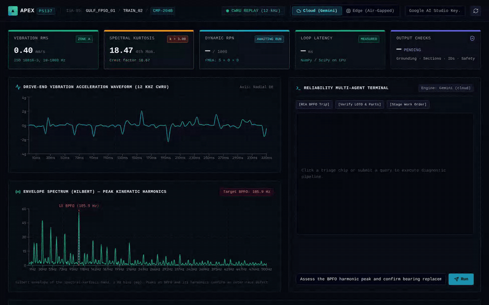

# APEX Industrial AI Reliability Engine

[](https://apex-reliability-engine.onrender.com)
[](docs/APEX_IEEE_Paper.pdf)


**Physics-grounded bearing fault diagnosis with retrieval-augmented maintenance reporting and fault-tolerant edge–cloud dispatch.**

APEX turns a raw vibration signal into a scoped maintenance work order. It identifies *which* bearing component is failing using bearing kinematics rather than a trained classifier, grades severity against ISO 10816-3, retrieves the matching maintenance precedent, and writes a report in which every number is verified against the measurement. It keeps working when the cloud language model is unavailable.

**Live demo:** [https://apex-reliability-engine.onrender.com](https://apex-reliability-engine.onrender.com)
<sub>Hosted on a free tier: if the page takes 30–60 s to load, the server is waking up.</sub>



📄 **Research paper:** [docs/APEX_IEEE_Paper.pdf](docs/APEX_IEEE_Paper.pdf)

---

## Run it locally — one command

Requirements: **Python 3.10+** and **Node.js 18+**.

```bash
git clone https://github.com/riaanoswal/apex-reliability-engine.git
cd apex-reliability-engine
python run.py
```

`run.py` installs anything missing on the first run, starts the backend and the dashboard, and opens your browser at the dashboard. **Ctrl+C** stops both. On Windows you can also double-click `START_DEMO.bat`.

The dashboard runs fully offline (**Edge / Air-Gapped** mode). To try **Cloud** mode, paste a Google AI Studio key into the key field — keys are never stored in the code.

---

## How it works

| Layer | What it does |
|---|---|
| **1. Acquisition** | 12 kHz drive-end vibration (CWRU benchmark), shaft speed, bearing geometry |
| **2. Kinematic DSP** | Spectral-kurtosis band selection → Hilbert envelope → each defect frequency (BPFO, BPFI, BSF) computed from bearing geometry and scored by envelope SNR averaged over its first three harmonics. Attribution only if the best score clears one calibrated threshold, otherwise *Normal*. **No training data.** |
| **3. Retrieval** | ISO 14224 maintenance-history search (TF-IDF / BM25), with the query conditioned on the current diagnosis |
| **4. Dispatch** | Language model writes the report from a structured evidence record only; output verification rejects any number not in that record; a dual-budget circuit breaker falls back to a deterministic report in ~1 µs if the cloud model fails |

---

## Key results

All figures come from `experiments/results/*.json` and are reported in the paper.

| Result | Value |
|---|---|
| Four-class accuracy, unseen load conditions (no training data) | **68.8%** |
| Accuracy excluding ball faults | **87.6%** |
| Fault detection: true-positive rate / precision | **81.3% / 97.2%** |
| Accuracy on **unseen defect sizes** — APEX rule engine | **69.4%** |
| Same test — supervised random forest | 96.0% → **46.3%** (memorises specimens) |
| Complete diagnostic path, median, CPU only | **5.9 ms** |
| Retrieval top-1: fixed query suffix → diagnosis-conditioned | 58.3% → **98.3%** |
| Upstream hang cost: sequential retry → circuit breaker | 54 s every request → one bounded attempt, then ~1 µs |
| Report availability across 7 injected failure modes | **100%** |

---

## Repository structure

```
backend/        FastAPI server (diagnosis, retrieval, dispatch, verification)
apex_core/      DSP and retrieval modules used by the server
frontend/       React + TypeScript SCADA dashboard
experiments/    Scripts behind every number in the paper, and their results/
data/           One CWRU recording (235_1.mat, outer-race fault) used by the demo
docs/           Research paper, demo recording, screenshot
run.py          One-command launcher
Dockerfile      Single-container image for hosting
render.yaml     Render deployment blueprint
```

## Reproducing the experiments

The committed `experiments/results/*.json` already hold every reported number. To regenerate them, download the [CWRU Bearing Data Center](https://engineering.case.edu/bearingdatacenter) 12 kHz drive-end data and normal-baseline data into `CWRU-dataset/` (`Normal/` and `12k_Drive_End_Bearing_Fault_Data/{IR,OR,B}/…`), or point `CWRU_ROOT` at it, then run the scripts in `experiments/`.

## Hosting

The `Dockerfile` builds the dashboard and serves it from the FastAPI backend, so one container runs the whole site. With `render.yaml`, the repository deploys on [Render](https://render.com) directly from GitHub.

---

**Author:** Riaan Oswal — Department of Artificial Intelligence and Robotics Engineering, Dayananda Sagar University, Bengaluru
